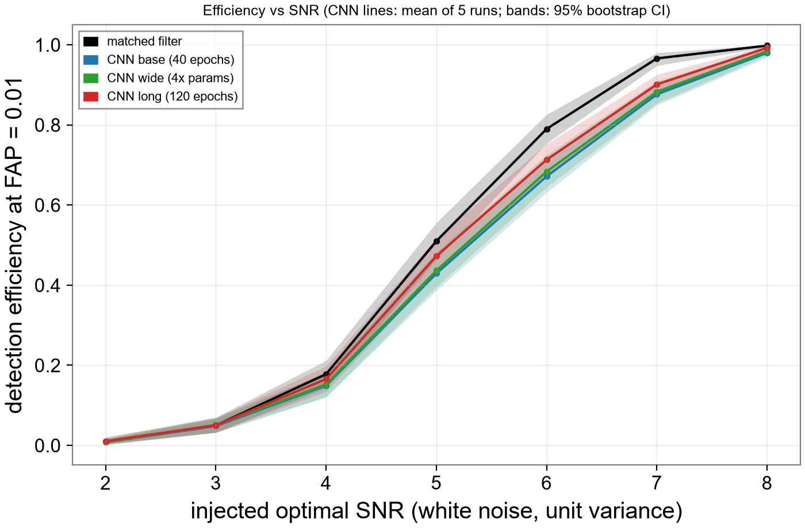

# gw-detector: matched filter vs a small CNN on LIGO-style data

This project re-detects GW150914 in public LIGO data (GWOSC) with a matched filter written from scratch,
then compares that matched filter against a small 1D CNN on simulated chirps in white Gaussian noise.
In the simulated test the matched filter is better than every CNN variant at SNR 6 (by 0.06 to 0.12 in
efficiency at false-alarm probability 0.01); at SNR 4 no CNN variant is statistically distinguishable from it.

The code is written to be readable: small functions and short comments explaining the why.

## Results (simulated white noise, fixed test set)

Efficiency = fraction of injected signals detected at a threshold that only 1% of noise-only examples exceed
(FAP 0.01). Test set: 20,000 noise-only examples and 500 signals at each integer SNR 1-10.
Every CNN number is the **mean of 5 training runs** (seeds 0-4) of what one trained network achieves.
The bracket is the 95% bootstrap CI (2,000 resamples of the test set, threshold re-derived from the resampled
noise each time). "seed std" is the spread of the 5 single-run efficiencies. Source: `results/bootstrap_ci.csv`.

| detector | params | time / run | SNR 4 | SNR 6 | SNR 8 |
|---|---|---|---|---|---|
| matched filter (102 templates) | n/a | n/a | 0.178 [0.144, 0.212] | 0.790 [0.754, 0.826] | 0.998 [0.994, 1.000] |
| CNN base (40 epochs) | 154,817 | 211 s | 0.150 [0.120, 0.181], seed std 0.008 | 0.672 [0.631, 0.712], seed std 0.013 | 0.980 [0.968, 0.989], seed std 0.004 |
| CNN wide (4x parameters, 40 epochs) | 599,297 | 333 s | 0.152 [0.121, 0.183], seed std 0.008 | 0.684 [0.645, 0.726], seed std 0.008 | 0.984 [0.974, 0.993], seed std 0.002 |
| CNN long (120 epochs) | 154,817 | 536 s | 0.166 [0.134, 0.198], seed std 0.003 | 0.713 [0.674, 0.752], seed std 0.008 | 0.992 [0.985, 0.998], seed std 0.001 |

Times are on an RTX 4060 Laptop GPU. The matched filter has no training; it needs a template bank.



ROC at SNR 6: `figures/11_roc_snr6.png`.

### Paired differences (same resamples for both detectors)
Matched filter minus CNN, efficiency at FAP 0.01, 95% bootstrap CI. A gap is called real only if the CI excludes 0.

| CNN variant | SNR 4 | SNR 6 | SNR 8 |
|---|---|---|---|
| base | 0.028 [-0.002, 0.059] | 0.118 [0.087, 0.151] | 0.018 [0.010, 0.029] |
| wide | 0.026 [-0.004, 0.058] | 0.106 [0.074, 0.137] | 0.014 [0.006, 0.024] |
| long | 0.012 [-0.016, 0.041] | 0.077 [0.047, 0.108] | 0.006 [0.0004, 0.012] |

### Key findings
- **SNR 4: not distinguishable.** All three CIs for the matched-filter-minus-CNN gap include 0 (long: 0.012 [-0.016, 0.041]).
  This is not evidence that the CNN equals the matched filter: gaps up to about 0.04 are still consistent with the data.
- **SNR 6: the matched filter wins.** By 0.118 (base), 0.106 (wide) and 0.077 (long) in efficiency; all three CIs exclude 0.
- **Longer training helps.** 3x the epochs (120 vs 40) raises single-run efficiency by 0.042 [0.028, 0.056] at SNR 6
  and 0.016 [0.005, 0.028] at SNR 4. It does not close the SNR 6 gap.
- **A wider network helps little.** 4x the parameters gives +0.012 [0.004, 0.023] at SNR 6 and +0.003 [-0.007, 0.010]
  at SNR 4 (not distinguishable from 0). Within these CIs it is not clearly better than the base network.

These CIs reflect resampling of the test set only. Whether the same differences hold for a different network
family, or for other training data, was not tested.

An ensemble (average of the 5 seeds' scores per example) does a bit better than a single run, e.g. base at SNR 6 is
0.696 [0.654, 0.738] vs the single-run mean 0.672. Its paired gaps to the matched filter are in the CSV (rows
`paired_diff_MF_minus_pooled`); there the SNR 4 gaps again include 0 and the SNR 6 gaps (0.094, 0.086, 0.064) exclude it.

## Why the matched filter wins
For a known signal in Gaussian noise, matched filtering is the optimal detector (Neyman-Pearson). Here the noise
is exactly white Gaussian and the signals are drawn from the same waveform family as the template bank, so
the matched filter is close to optimal by construction. The interesting question is therefore how close a learned
detector gets without being handed the templates. Answer measured here: close at SNR 4 (within test noise) and at
SNR 8 (0.980-0.992 vs 0.998), but a clear gap near SNR 6.

## Method
- **Data.** GW150914 from GWOSC (32 s at 4096 Hz, H1 and L1) is used for validation against a real event.
  The controlled detector comparison uses simulated chirps (20-50 solar masses, 4 s at 2048 Hz) in unit-variance white Gaussian noise.
- **Preprocessing.** Welch PSD (4 s Hann segments, 50% overlap, median average), whitening by the amplitude spectral
  density, 20-500 Hz band-pass with raised-cosine edges, Tukey taper.
- **Templates.** TaylorF2 frequency-domain inspiral up to 2PN phase, f_low 20 Hz, cutoff fixed at 3x the ISCO
  frequency. Template bank: 102 templates over (chirp mass, eta). Mismatch against 2,000 random injections:
  mean 0.0033, 95th percentile 0.0072, worst 0.054. The matched filter takes the maximum over templates and time.
- **CNN.** 5 conv blocks (kernels 31/15/7/5/5, max-pool 4/4/4/2/2) -> global max over time -> 64-unit dense layer -> 1 logit.
  154,817 parameters (wide variant: 2x channels, 599,297). Binary cross-entropy, Adam (lr 1e-3), cosine learning-rate
  decay, batch 128, 20,000 fresh simulated examples per epoch with SNR uniform in 1-12 and half the examples noise-only.
  The best epoch is chosen by validation loss.
- **Metrics.** Efficiency at a fixed false-alarm probability (threshold taken from noise-only scores), ROC curve, AUC,
  bootstrap CIs (`scripts/bootstrap_ci.py`).
- **Train / validation / test separation.** Training data come from seeds around 1e11 (new data every epoch),
  validation from seed 2002 (6,000 examples), the test set from seeds 3003-3013. A unit test checks
  that these never overlap. The test set is saved to disk and is identical for the matched filter and all CNN runs.

## Validation against the real event (GW150914, `results/tier1_gw150914.json`)
| | measured |
|---|---|
| H1 SNR | 17.2 |
| L1 SNR | 11.4 |
| combined SNR | **20.6** (published matched-filter SNR: about 24) |
| L1 arrival minus H1 arrival | -7.1 ms (L1 first; limit from light travel time is 10 ms) |

Template: chirp mass scan 20-40 solar masses in 1-solar-mass steps, mass ratio fixed at 0.8, 2PN, 3x ISCO cutoff.
Away from the event, mean H1 SNR is 1.28 (pure noise should give about 1.25). Figure: `figures/04_gw150914_detection.png`.
With a cutoff at the ISCO the same search gives only 12.3, because an inspiral-only template has no merger.
This shows the event is recoverable; no false-alarm rate was measured, so it says nothing about significance.

## Limitations
- The 3x ISCO cutoff was chosen after seeing a sweep on GW150914 (2x: 17.8, 3x: 20.6, 4x: 20.1), so 20.6 is optimistic.
  It was then fixed for all later work.
- LALSuite is not available on Windows, so the template generator and bank are my own implementation
  (inspiral only, non-spinning), not checked against LAL waveforms. The recovered SNR (20.6) is below the published value (about 24).
- The controlled experiments use simulated white Gaussian noise, not real detector noise (which is coloured and has glitches).
  Nothing here says how the CNN would behave on real noise.
- All signals in the test set are simulated and come from the same waveform family as the template bank, so only grid
  mismatch is modelled, not waveform error. Real data beyond GW150914 were not evaluated.
- One fixed test set (500 signals per SNR). The bootstrap above quantifies the resulting sampling uncertainty (it
  is the dominant one: about +-0.03 to +-0.04 at SNR 4-6), but a different test draw could still shift the point values.
- The seed std covers training randomness only. Only one network family was explored (two sizes, two training lengths).
- PSD for the real event is estimated from the same 32 s that contains it.
- The AUC at SNR 8 for the matched filter is 1.000 (earlier README versions printed "n/a", an omission).

## Reproduce
Windows, PowerShell. Python 3.14.5, torch 2.14.1+cu130, NumPy 2.5.4, SciPy 1.18.1 (as installed in this `.venv`).
Install the GPU build of torch first: `pip install torch --index-url https://download.pytorch.org/whl/cu130`.
```powershell
python -m venv .venv
.\.venv\Scripts\python.exe -m pip install -r requirements.txt
.\.venv\Scripts\python.exe -m pytest -q                      # unit tests
.\.venv\Scripts\python.exe scripts\detect_gw150914.py        # real event (needs internet once; cached in data/)
.\.venv\Scripts\python.exe scripts\build_test_set.py         # fixed test set -> data/test_set/
.\.venv\Scripts\python.exe scripts\run_baseline.py           # matched-filter scores -> results/
.\.venv\Scripts\python.exe scripts\run_experiments.py        # 3 variants x 5 seeds -> results/runs/
.\.venv\Scripts\python.exe scripts\summarise_runs.py         # seed mean/std
.\.venv\Scripts\python.exe scripts\bootstrap_ci.py           # results/bootstrap_ci.csv (about 25 s)
.\.venv\Scripts\python.exe scripts\make_figures.py           # figures/10, 11
```
The test set (`data/test_set/`, 781 MB, `X.npy` plus labels) is not stored in the repository. `build_test_set.py`
regenerates it from fixed seeds (3003-3013), so every run produces the same examples; `run_baseline.py` and
`run_experiments.py` read it from there. The GW150914 strain is downloaded from GWOSC on first use and cached in `data/`.

Runtime: about 1.5 hours of GPU time in total on an RTX 4060 (the sweep was restarted once after a crash).
`run_experiments.py` is the long step. `scripts/train_cnn.py` and `evaluate_cnn.py` are the earlier single-run
version (figures 08/09).

## Repository layout
```
src/gwdetector/   data, psd, whiten, template, matched_filter, simulate, bank, baseline, metrics, testset, cnn, train
scripts/          plot_raw_strain, compute_psd, survey_data, detect_gw150914 (real event);
                  simulate_demo, build_test_set, run_baseline (simulated data and matched filter);
                  train_cnn, evaluate_cnn (first single run); run_experiments, summarise_runs,
                  bootstrap_ci, make_figures (final results)
tests/            unit tests for every module in src/gwdetector
results/          JSON/CSV outputs; results/runs/ holds each run's saved test scores (*_scores.npy)
figures/          01-04 real data and GW150914, 05-09 simulation, baseline and first CNN, 10-11 final figures
data/             downloaded strain and the generated test set (not tracked)
```

## References
- GWOSC, the Gravitational Wave Open Science Center: https://gwosc.org (GW150914 strain data).
- Abbott et al. (LIGO Scientific and Virgo Collaborations), "Observation of Gravitational Waves from a Binary Black Hole
  Merger", Phys. Rev. Lett. 116, 061102 (2016).
- Gabbard, Williams, Hayes, Messenger, "Matching matched filtering with deep networks for gravitational-wave
  astronomy", arXiv:1712.06041. Used as the model for the evaluation style (efficiency at fixed FAP); my numbers have not been
  compared with theirs.
